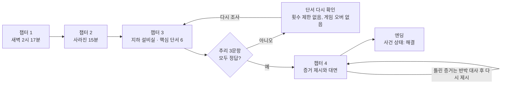

# PRD — 마지막 퇴실 기록

작성일: 2026-10-29

## 1. 개요

《마지막 퇴실 기록》은 10\~15분 안에 끝까지 플레이할 수 있는 웹 브라우저용 심리 공포 추리 게임이다. 플레이어는 철거를 앞둔 사무실 건물의 야간 경비원이 되어, 3년 전 실종된 직원의 퇴실 기록이 매일 새벽 2시 17분에 출력되는 이유를 조사한다.

| 항목 | 내용 |
| --- | --- |
| 제목 | 마지막 퇴실 기록 |
| 장르 | 심리 공포, 미스터리, 추리 스릴러 |
| 플랫폼 | 웹 브라우저 (PC, 태블릿, 모바일) |
| 개발 방식 | HTML, CSS, JavaScript 단일 `index.html` |
| 플레이 시간 | 약 10\~15분 |
| 그래픽 | 이미지 파일 없이 CSS 효과와 텍스트 중심 |
| 핵심 플레이 | 스토리 진행, 장소 조사, 단서 수집, 선택지, 추리, 엔딩 |

### 1.1 기획 의도

- 초자연 현상처럼 보이는 사건을 플레이어가 직접 조사해 인간의 범죄와 은폐로 밝혀내는 경험을 만든다.
- 점프 스케어가 아니라 평범한 사무실이 조금씩 이상하게 느껴지는 심리적 공포를 목표로 한다.
- 모든 공포 연출은 사건의 단서와 연결되어, 무서움이 곧 추리의 실마리가 되도록 한다.

### 1.2 목표

1. 시작부터 엔딩까지 막힘 없이 진행되는 완성형 게임을 제공한다.
2. 6개의 핵심 단서가 하나의 논리적인 진실로 수렴하게 한다.
3. 범인, 피해자에게 일어난 일, 기록이 반복 출력된 이유를 플레이어가 엔딩에서 모두 이해하게 한다.
4. 설치 없이 파일을 열면 바로 실행되게 한다.

### 1.3 비목표

- 귀신 등 초자연적 존재의 실제 등장
- 추가 범인, 복잡한 음모, 불필요한 반전
- 게임 오버로 처음부터 다시 하게 만드는 구조
- 열린 결말 또는 멀티 엔딩
- 서버, 계정, 외부 라이브러리, 외부 이미지와 음성 파일

### 1.4 대상 사용자

복잡한 조작 없이 클릭만으로 스토리를 따라가며 추리하는 것을 좋아하는 플레이어. 텍스트 어드벤처와 방탈출, 추리 비주얼 노벨에 익숙한 사용자를 1차 대상으로 한다.

## 2. 스토리 및 세계관

사건의 범인은 관리소장 강태식이며, 반복되는 퇴실 기록은 그가 3년 전 설정하고 잊어버린 자동 출력 작업이다. 이 설정은 개발 전 과정에서 변경하지 않는다.

### 2.1 기본 설정

- 배경: 철거를 앞둔 오래된 사무실 건물, 일주일 야간 경비 아르바이트
- 발단: 근무 첫날 새벽 2시 17분, 관리실 프린터에서 `퇴실 완료 — 직원: 서하린 — 02:17`이 출력된다.
- 모순: 서하린은 3년 전 이 건물에서 실종됐고, CCTV에는 그녀가 나가는 모습이 없다.
- 반복: 강태식은 시스템 오류라고 하지만, 같은 기록이 매일 02:17에 다시 출력된다.

### 2.2 등장인물

| 인물 | 역할 | 알고 있는 것 | 행동 변화 |
| --- | --- | --- | --- |
| 주인공 | 신입 야간 경비원, 플레이어 시점 | 시작 시 사건에 대해 아무것도 모름 | 조사한 단서에 따라 질문과 추리가 달라짐 |
| 강태식 | 건물 관리소장, 범인 | 사건의 전모 | 처음에는 친절 → 지하 설비실·출입 기록 조사 시 예민 → 증거 앞에서 부인 후 인정 |
| 서하린 | 3년 전 실종된 직원, 피해자 | 안전 점검 기록 조작 사실 | 직접 등장하지 않고 메모와 원본 자료로만 등장 |

### 2.3 사건의 실제 진실 (제작자 전용, 플레이어에게 일괄 공개 금지)

1. 서하린이 강태식의 안전 점검 기록 조작을 알아내고 원본 자료를 확보해 외부에 알리려 했다.
2. 강태식은 지하 설비실에서 서하린과 다투다 증거를 빼앗으려 밀쳐, 서하린이 사용 중단된 화물용 엘리베이터 통로 아래로 추락해 사망했다.
3. 강태식은 서하린의 출입 카드로 정상 퇴실한 것처럼 기록을 조작하고, 관련 CCTV 영상(02:10\~02:25)을 삭제했다.
4. 조작 기록이 정상 처리되는지 확인하려고 자신의 계정으로 매일 02:17 퇴실 기록 자동 출력 작업을 만들었고, 지우지 않아 3년간 계속 실행됐다.
5. 따라서 반복 출력은 초자연 현상이 아니라 인간이 남긴 자동화 작업의 흔적이다.

### 2.4 강태식 진술의 거짓 지점

강태식은 "우발적 사고였고 고의는 없었다"고 주장한다. 그러나 사고 뒤 신고 대신 CCTV 삭제, 퇴실 기록 조작, 통로 봉쇄를 연달아 했다는 점이 기록으로 드러나, 진술이 사건 은폐를 위한 거짓임이 밝혀진다.

## 3. 게임 진행 구성

게임은 4개 챕터와 추리 단계, 엔딩으로 구성되며 총 플레이 시간은 약 10\~15분이다. 챕터 사이는 선형으로 이어지고, 챕터 안에서는 조사 순서를 플레이어가 고른다.

| 단계 | 목표 시간 | 주요 장소 | 다음 단계로 넘어가는 조건 |
| --- | --- | --- | --- |
| 챕터 1. 새벽 2시 17분 | 2\~3분 | 관리실, CCTV실 | 출력 기록 조사 + CCTV 확인 완료 |
| 챕터 2. 사라진 15분 | 3\~4분 | CCTV실, 사무실, 관리실 | CCTV 삭제 기록 + 출입 기록 불일치 발견 |
| 챕터 3. 지하 설비실 | 4\~5분 | 지하 설비실, 사무실, 관리실 | 핵심 단서 6개 전부 획득 |
| 추리 단계 | 1\~2분 | 관리실 | 3개 문항 모두 정답 |
| 챕터 4. 마지막 퇴실 기록 | 2\~3분 | 관리실 | 증거 제시로 강태식의 진술 반박 |
| 엔딩 | 1분 | 관리실 → 건물 밖 | 자동 진행 |

추리에서 틀리거나 대면에서 잘못된 증거를 내도 진행이 끊기지 않고, 다시 조사한 뒤 같은 지점으로 돌아온다.

### 3.1 챕터 1. 새벽 2시 17분

- 도입: 첫 야간 근무. 깜빡이는 형광등, 멀리서 들리는 기계음, 시계 02:16 → 02:17.
- 사건: 프린터가 스스로 작동해 서하린의 퇴실 기록을 출력한다.
- 선택: 출력 기록 조사 / CCTV 확인 / 관리소장에게 연락 (순서 자유).
- CCTV: 정문·후문 모두 02:17 전후로 아무도 나가지 않았다.
- 강태식 통화: "오래된 시스템 오류입니다. 신경 쓰지 마세요."
- 종료: 다음 날 밤, 같은 시각에 같은 기록이 다시 출력된다.

### 3.2 챕터 2. 사라진 15분

- 실종 당일 CCTV 백업을 확인하면 02:10\~02:25 구간만 노이즈로 손상·삭제돼 있다.
- 삭제 기록(시스템 로그)을 열면 삭제 계정이 `kang.ts`(강태식)로 나타난다.
- 사무실의 직원 출입 기록부에서 서하린의 퇴실 기록이 실제 출입 내역과 맞지 않음을 발견한다.
- 강태식 대화: 처음에는 "시스템 오류"를 주장하다가, 삭제 계정을 구체적으로 물으면 대답을 피하고 "지하에는 내려가지 마세요"라고 경고한다. 이 경고가 지하 설비실로의 다음 목표가 된다.

### 3.3 챕터 3. 지하 설비실

- 출입 제한 구역. 관리실 열쇠함의 지하 열쇠를 얻어야 열린다.
- 핵심 단서 6개를 연쇄적으로 발견한다(상세는 4장 단서 설계).
- 설비실 안에서는 기계음이 멈추고, 봉쇄된 엘리베이터 문 아래로 차가운 바람이 올라온다.

### 3.4 추리 단계

관리실에서 플레이어가 사건을 직접 정리한다. 문항과 선택지는 5장 기능 요구사항의 추리 단계 항목에 정의한다.

### 3.5 챕터 4. 마지막 퇴실 기록

1. 강태식이 관리실로 돌아와 주인공이 지하에 내려갔다는 것을 알아차린다.
2. 대면 라운드: 강태식의 주장마다 플레이어가 반박할 단서를 제시한다.
3. "시스템 오류" → 자동 출력 작업 제시 / "그날 지하에 없었다" → 설비실 출입 기록 제시 / "그녀가 스스로 나갔다" → 퇴실 기록 사후 입력 기록 제시 / "다툰 적 없다" → 서하린의 메모 제시.
4. 강태식이 다툰 사실을 인정하고 "사고였다"고 주장한다.
5. 마지막 반박: 삭제된 CCTV, 조작된 퇴실 기록, 봉쇄 문서를 연결해 사고 후 의도적 은폐를 밝힌다.
6. 주인공이 경찰에 신고한다. 봉쇄된 통로에서 서하린의 유해와 소지품이 발견되고, 강태식은 서하린의 죽음과 증거 은폐 혐의로 체포된다.

### 3.6 엔딩

1. 관리실 프린터가 마지막으로 작동한다: `퇴실 기록 — 서하린 — 02:17`
2. 잠시 후 화면에 `사건 상태: 해결`이 나타난다.
3. 내레이션으로 자동 출력 작업이 경찰에 의해 중지됐음을 설명하고, 주인공은 건물을 빠져나온다.
4. 마지막 내레이션: “오늘은 아무도 기록에서 사라지지 않았다.”
5. 사건 요약 화면(범인, 사망 경위, 반복 출력 이유)과 ‘처음부터 다시’ 버튼을 표시한다.

## 4. 단서 설계

단서는 총 11개(보조 5 + 핵심 6)이며, 하나를 발견하면 다음 조사 대상이 열리는 연쇄 구조로 설계한다. 모든 단서는 2.3의 진실 중 최소 한 항목을 직접 뒷받침한다.

### 4.1 보조 단서 (챕터 1\~2)

| ID | 단서 | 위치 | 해금 조건 | 의미 | 열리는 다음 조사 |
| --- | --- | --- | --- | --- | --- |
| A1 | 02:17 퇴실 출력지 | 관리실 프린터 | 챕터 1 시작 | 실종자의 퇴실 기록이 매일 같은 시각에 출력됨 | CCTV 확인 |
| A2 | 오늘 밤 CCTV | CCTV실 모니터 | 없음 | 02:17에 아무도 나가지 않음 → 출력은 실제 퇴실이 아님 | 실종 당일 CCTV 백업 |
| A3 | 실종 당일 CCTV 공백 | CCTV실 백업 서버 | 챕터 2 시작 | 02:10\~02:25 구간만 사라짐 | 삭제 로그 |
| A4 | CCTV 삭제 로그 | CCTV실 시스템 로그 | A3 획득 | 삭제 계정 `kang.ts` = 강태식 | 강태식 질문 ‘삭제 계정’ |
| A5 | 출입 기록 불일치 | 사무실 출입 기록부 | 챕터 2 시작 | 퇴실 기록은 있지만 후문·정문 게이트 통과 기록이 없음 | 강태식 질문 ‘출입 기록’ |

### 4.2 핵심 단서 (챕터 3)

| ID | 단서 | 위치 | 해금 조건 | 사건과의 관련 | 열리는 다음 조사 |
| --- | --- | --- | --- | --- | --- |
| K1 | 서하린의 메모 “소장님이 원본을 가져가려 한다.” | 설비실 공구함 아래 | 설비실 진입 | 서하린이 강태식을 두려워했고, ‘원본’이 있었음 | ‘원본’ 찾기: 문서 캐비닛 |
| K2 | 조작된 안전 점검 문서 vs 실제 원본 | 설비실 문서 캐비닛 | K1 획득 | 강태식이 ‘부적합’을 ‘적합’으로 고침 = 범행 동기 | ‘그날 누가 여기 있었나’: 설비실 출입 단말기 |
| K3 | 실종 당일 설비실 출입 기록 | 설비실 출입 단말기 | K2 획득 | 01:58 서하린 입실, 02:03 강태식 입실, 02:31 강태식만 퇴실 | 서하린 퇴실 기록 원장 확인 |
| K4 | 퇴실 기록 사후 입력 내역 | 관리실 출입 관리 PC | K3 획득 | 서하린 ‘퇴실 02:17’은 02:48에 관리자 계정으로 수동 입력됨 | 같은 PC의 예약 작업 목록 |
| K5 | 3년 전 생성된 자동 출력 작업 | 관리실 출입 관리 PC | K4 획득 | `kang.ts` 계정이 매일 02:17 퇴실 기록 출력 작업을 만듦 = 반복 출력의 정체 | ‘그녀는 어디에?’: 봉쇄 구역 |
| K6 | 화물용 엘리베이터 통로 봉쇄 문서 | 설비실 봉쇄된 엘리베이터 문 앞 | K3 획득 | 통로는 점검 ‘부적합’이었고, 실종 이틀 뒤 강태식 지시로 긴급 봉쇄됨 | 추리 단계 해금 |

### 4.3 연결 규칙

- 단서를 얻으면 내레이션 1\~2문장으로 ‘이것이 무엇을 의미하는지’와 ‘다음에 무엇을 확인해야 하는지’를 제시한다.
- 해금된 다음 조사 오브젝트에는 ‘새로운’ 표시를 붙인다.
- 최종 연결: A4(CCTV 삭제) + K3(설비실 출입) + K4(퇴실 조작) + K1(메모) = 강태식이 현장에 있었고 사건을 은폐했다. K2 = 동기, K6 = 유해의 위치, K5 = 반복 출력의 이유.

## 5. 기능 요구사항

모든 기능은 마우스 클릭(터치 포함)만으로 조작되며, 플레이어가 어떤 순서로 진행해도 엔딩에 도달할 수 있어야 한다. 우선순위 P0는 제출본에 반드시 포함, P1은 권장이다.

| ID | 기능 | 요구사항 | 우선순위 |
| --- | --- | --- | --- |
| F1 | 대사 진행 | 대사·내레이션을 한 문장씩 타이핑 효과로 표시, 클릭 시 다음 문장. 타이핑 중 클릭하면 즉시 전체 표시 | P0 |
| F2 | 화자 표시 | 내레이션 / 주인공 / 강태식 / 시스템(프린터·단말기)을 이름표와 색으로 구분 | P0 |
| F3 | 진행 표시 | 상단 바에 현재 챕터명, 게임 내 시각, 단서 수집 현황(예: 7/11) 표시 | P0 |
| F4 | 대사 로그 | 버튼으로 지나간 대사 전체를 스크롤 창에서 다시 확인 | P0 |
| F5 | 장소 이동 | 관리실, CCTV실, 사무실, 지하 설비실 버튼. 잠긴 장소는 자물쇠 표시와 잠긴 이유 안내 | P0 |
| F6 | 오브젝트 조사 | 장소별 조사 대상 3\~5개. 미조사 / 조사 완료 / 새로 열림을 아이콘과 색으로 구분 | P0 |
| F7 | 단서 목록 | 획득한 단서를 파일 폴더 UI에 저장, 클릭 시 기록지 형태로 전문 표시. 새 단서는 획득 알림 | P0 |
| F8 | 단서 기반 해금 | 단서 획득 시 연결된 오브젝트, 장소, 질문이 열림(4장 표 기준) | P0 |
| F9 | 대화 선택지 | 강태식에게 할 질문을 고름. 단서에 따라 질문이 추가되고, 이미 한 질문은 다시 고를 수 있음 | P0 |
| F10 | 대면 증거 제시 | 챕터 4에서 강태식의 주장마다 단서 목록에서 증거를 골라 제시. 틀리면 반박 대사 후 재시도 | P0 |
| F11 | 추리 단계 | 아래 3문항을 모두 맞히면 챕터 4로 진행 | P0 |
| F12 | 재시작 | 상단 메뉴의 ‘처음부터’ 버튼으로 모든 상태 초기화 (확인 팝업은 게임 내 모달로 구현) | P0 |
| F13 | 사운드 토글 | Web Audio API 효과음 켜기/끄기, 기본값 끔 | P1 |
| F14 | 자동 저장 | localStorage에 진행 상황 저장, 다시 열면 이어하기 | P1 |
| F15 | 힌트 | 다음 목표를 한 줄로 알려주는 ‘수첩’ 버튼 | P1 |

### 5.1 추리 단계 문항

| 문항 | 선택지 | 정답 |
| --- | --- | --- |
| Q1. 서하린의 죽음에 책임이 있는 사람은? | 강태식 / 서하린 본인(자발적 실종) / 알 수 없는 외부인 / 설명할 수 없는 현상 | 강태식 |
| Q2. 서하린에게 무슨 일이 있었나? | 건물을 떠나 잠적 / 안전 점검 조작 증거를 두고 다투다 엘리베이터 통로로 추락 / 설비실 사고로 혼자 사망 | 두 번째 |
| Q3. 퇴실 기록이 매일 02:17에 출력된 이유는? | 서하린의 혼이 남긴 메시지 / 노후한 프린터 고장 / 강태식이 만든 자동 출력 작업이 3년간 남아 있었음 | 세 번째 |

- 틀린 문항이 있으면 무엇이 틀렸는지 알려주고, 관련 단서 ID를 힌트로 제시한 뒤 단서 목록과 조사 화면으로 돌아갈 수 있게 한다.
- 횟수 제한이나 게임 오버는 없다.

### 5.2 막힘 방지 규칙

- 모든 핵심 단서는 단서 연쇄만 따라가면 반드시 획득 가능하며, 놓칠 수 있는 일회성 이벤트는 없다.
- 장소와 오브젝트는 언제든 다시 방문·조사할 수 있다.
- 다음 챕터로 넘어가는 버튼은 필수 단서를 모두 얻었을 때만 활성화되고, 비활성 상태에서는 ‘아직 확인하지 않은 것이 있다’는 안내를 보여준다.

## 6. 공포 연출 및 UI/UX

공포는 평범한 사무실이 조금씩 어긋나는 감각으로 만들고, 모든 연출은 단서와 연결한다. 귀신이나 초자연적 존재는 등장하지 않는다.

### 6.1 공포 연출 목록

| 연출 | 발생 시점 | 연결된 단서·진실 |
| --- | --- | --- |
| 형광등 깜빡임 (화면 밝기 미세 변화) | 상시, 02:17 직전 강화 | 오래된 건물, 시각에 대한 긴장 |
| 프린터 출력 효과 (종이가 아래로 밀려 나오며 글자 한 줄씩 인쇄) | 매 챕터 02:17, 엔딩 | A1, K5 (자동 출력 작업) |
| CCTV 노이즈·스캔라인·타임코드 점프 | CCTV실 조사 | A2, A3 (삭제된 15분) |
| 시계 02:16에서 멈춘 듯한 정적 (2\~3초 입력 무시) | 챕터 1 출력 직전 | 반복되는 02:17 |
| 문구가 잠깐 바뀌었다 돌아옴 (예: ‘퇴실 완료’ → ‘퇴실 미완료’) | 챕터 2 출입 기록부 | A5, K4 (실제로 퇴실하지 않음) |
| 기계음이 갑자기 멈추는 정적 | 지하 설비실 진입 | 현장에 들어섰다는 신호 |
| 봉쇄된 엘리베이터 문 틈의 차가운 바람 묘사 | K6 조사 | 유해의 위치 |
| 화면 가장자리 어두워짐 (비네팅 강화) | 챕터가 진행될수록 | 진실에 가까워짐 |

- 깜빡임은 초당 3회 이하, 밝기 변화 폭을 작게 유지한다(광과민성 배려).
- `prefers-reduced-motion` 설정 시 깜빡임·흔들림을 끄거나 줄인다.
- 효과음은 Web Audio API로 생성하며 오디오 파일을 쓰지 않는다: 형광등 험(저주파), 프린터 동작음, 노이즈, 단서 획득 알림음.

### 6.2 화면 구성

| 영역 | 내용 |
| --- | --- |
| 상단 바 | 챕터명, 게임 내 시각, 단서 수, 로그·단서·사운드·처음부터 버튼 |
| 장면 패널 | 현재 장소의 모니터/기록지/CCTV 스타일 화면과 조사 오브젝트 버튼 |
| 장소 이동 바 | 4개 장소 버튼, 현재 위치 강조, 잠김 표시 |
| 대사창 | 화자 이름표, 본문, ‘▼ 클릭하여 계속’ 표시, 선택지 버튼 |
| 모달 | 단서 목록/상세, 대사 로그, 추리 단계, 재시작 확인 |

### 6.3 비주얼 스타일

- 색상: 배경 검정(#0b0c0d)과 어두운 회색(#1a1c1e), 낡은 형광등 녹백색(#cfe3d0) 글자, 경고 적갈색(#b33a3a) 강조, CRT 모니터 녹색(#7fd18a) 단말기 글자.
- 스타일: CRT 모니터(스캔라인, 글로우), 누런 기록지(단서 상세), CCTV 패널(타임코드, REC 표시).
- 글꼴: 시스템 기본 글꼴 + 단말기·출력물은 monospace. 본문 16px 이상, 배경 대비 4.5:1 이상.
- 버튼: 최소 44×44px, hover·focus 시 테두리 밝아짐. 클릭 가능한 요소는 항상 테두리가 보이게 한다.
- 반응형: 360px 모바일부터 1920px 데스크톱까지. 768px 미만에서는 장소 바와 오브젝트가 세로로 쌓인다.

## 7. 기술 요구사항

게임은 외부 의존성 없는 단일 `index.html` 파일로, 더블클릭해 브라우저로 열면 바로 실행된다.

### 7.1 실행 환경

- 파일: `index.html` 1개 (HTML + `<style>` + `<script>` 내장)
- 외부 라이브러리, CDN, 웹폰트, 이미지, 오디오 파일, 서버 사용 안 함
- `file://`로 열어도 동작 (fetch, 모듈 import 사용 안 함)
- 지원 브라우저: Chrome, Edge, Firefox, Safari 최신 버전

### 7.2 코드 구조

| 구성 요소 | 역할 |
| --- | --- |
| `SCENES` 데이터 | 장면별 대사 배열(화자, 문장, 연출 태그), 선택지, 다음 장면 ID |
| `LOCATIONS` 데이터 | 장소별 오브젝트, 해금 조건, 조사 시 실행할 장면 |
| `CLUES` 데이터 | 단서 ID, 제목, 본문, 의미 설명, 해금 대상 |
| `state` 객체 | 현재 챕터·장면·장소, 획득 단서, 조사한 오브젝트, 한 질문, 로그, 사운드 설정 |
| 엔진 함수 | `playScene()`, `advance()`, `gotoLocation()`, `inspect()`, `addClue()`, `presentEvidence()`, `checkDeduction()`, `resetGame()` |
| 연출 함수 | `flicker()`, `printOut()`, `cctvNoise()`, `silence()`, `glitchText()`, `sfx()` |

- 스토리 내용은 데이터로, 진행 로직은 엔진 함수로 분리해 대사 수정이 코드 수정 없이 가능하게 한다.
- 데이터에서 참조하는 모든 장면·단서·오브젝트 ID는 실제로 존재해야 하며, 시작 시 참조 무결성 검사 함수로 콘솔에 오류를 출력한다.

### 7.3 상태 관리와 재시작

- 초기 상태는 `createInitialState()` 함수가 매번 새 객체로 만든다.
- `resetGame()`은 상태 재생성, localStorage 삭제, 진행 중인 타이머·연출 해제, 화면 재렌더링을 모두 수행한다.
- 자동 저장은 장면 전환·단서 획득 시 수행하며, 저장 데이터가 깨져 있으면 무시하고 새로 시작한다.

### 7.4 사운드

- Web Audio API(OscillatorNode, 노이즈 버퍼)로 효과음을 즉석 생성한다.
- 브라우저 자동재생 정책에 따라 사용자가 사운드를 켠 뒤에만 AudioContext를 생성한다.
- 사운드가 지원되지 않아도 게임 진행에는 영향이 없다.

## 8. 수용 기준, 리스크, 일정

아래 체크리스트를 모두 통과해야 제출 가능한 완성본으로 본다.

### 8.1 수용 기준 (QA 체크리스트)

- [ ] 게임 시작부터 엔딩 문구 “오늘은 아무도 기록에서 사라지지 않았다.”까지 끊김 없이 진행된다.
- [ ] 보조 단서 5개와 핵심 단서 6개를 모두 실제로 획득할 수 있다.
- [ ] 모든 선택지가 정의된 장면으로 이동하고, 동작하지 않는 버튼이 없다.
- [ ] 단서를 어떤 순서로 조사해도 영구적으로 막히는 상태가 없다.
- [ ] 추리 단계에서 틀려도 단서 확인 후 다시 도전할 수 있다.
- [ ] 대면에서 잘못된 증거를 제시해도 다시 선택할 수 있다.
- [ ] 범인, 서하린의 사망 경위, 반복 출력의 이유가 엔딩에서 명확히 설명된다.
- [ ] 사건의 진실과 모든 단서가 논리적으로 모순되지 않는다(시각, 계정명, 장소 일치).
- [ ] ‘처음부터’ 버튼으로 단서, 로그, 조사 여부, 장소, 저장 데이터가 모두 초기화된다.
- [ ] 대사 로그에서 지난 대사를 모두 확인할 수 있다.
- [ ] 360px 모바일과 1920px 데스크톱에서 레이아웃이 무너지지 않는다.
- [ ] 브라우저 콘솔에 오류가 없다.
- [ ] 처음 플레이하는 테스터 기준 10\~15분 안에 엔딩에 도달한다.

### 8.2 리스크와 대응

| 리스크 | 영향 | 대응 |
| --- | --- | --- |
| 단서 연결이 약해 플레이어가 다음 할 일을 모름 | 이탈, 플레이 시간 초과 | 획득 시 다음 대상 안내 내레이션, ‘새로운’ 표시, 수첩 힌트 |
| 기술 설정(자동 출력 작업)이 어렵게 느껴짐 | 엔딩 납득도 저하 | ‘예약 작업 = 정해진 시각에 자동으로 실행되는 명령’이라는 한 줄 설명을 단서에 포함 |
| 깜빡임 연출이 눈의 피로나 광과민성을 유발 | 접근성 문제 | 밝기 변화 제한, reduced-motion 대응 |
| 단일 파일이 길어져 참조 오류 발생 | 버튼 미작동, 진행 불가 | 데이터/엔진 분리, 시작 시 참조 무결성 검사, 전체 경로 수동 테스트 |
| 모바일에서 사운드 자동재생 차단 | 효과음 미출력 | 사운드 기본 끔, 사용자 클릭 후 활성화 |

### 8.3 개발 일정 (안)

1. 기획 확정: PRD 제출 및 피드백 반영
2. 스토리 데이터 작성: 전체 대사, 단서 본문, 선택지
3. 엔진 구현: 대사 진행, 장소·조사, 단서, 추리, 대면, 재시작
4. 연출·UI: 공포 효과, CRT/CCTV/기록지 스타일, 반응형, 효과음
5. QA: 8.1 체크리스트 전체 통과 확인 후 제출

미정 사항: 제출 마감일에 맞춘 단계별 날짜
